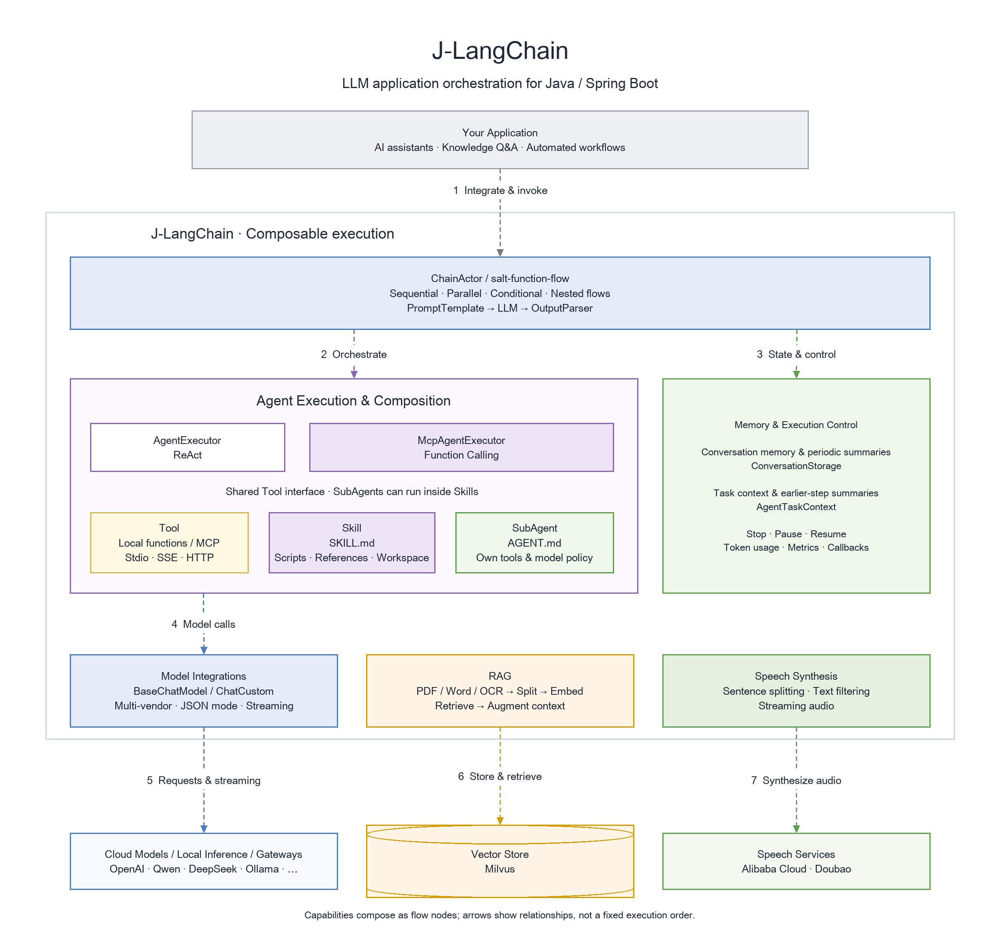

<div align="center">

# J-LangChain

**AI workflows and agents for Java / Spring Boot**

Compose models, business tools, MCP, Skills, and SubAgents into workflows you can control.

[](https://search.maven.org/artifact/io.github.flower-trees/j-langchain)
[](./LICENSE)
[](https://www.oracle.com/java/)
[](https://spring.io/projects/spring-boot)

[English](./README.md) | [中文](./README_CN.md)

[Quick start](#quick-start) · [Business tool agent](#tool-agent) · [Architecture](#architecture) · [Examples and tutorials](#examples) · [API](./docs/api/reference.md)

</div>

## Why J-LangChain?

| Capability | What you can do |
|---|---|
| **Compose workflows and agents** | Use salt-function-flow to compose models, tools, and agents as sequential, parallel, conditional, and nested flow nodes. |
| **Tool → Skill → SubAgent** | Start with annotated business methods, then add MCP tools, SKILL.md skills, and autonomous subagents through a shared Tool interface. |
| **Control and observe long tasks** | Stop or pause at safe checkpoints, resume with context, manage history through summaries, and inspect token usage, execution metrics, and callbacks. |

<a id="quick-start"></a>

## Quick start

Use a Java 17 / Spring Boot 3.2.x Maven application and an Alibaba Cloud Qwen API key. Model calls require network access and available quota.

**1. Add the dependency**

```xml
<dependency>
    <groupId>io.github.flower-trees</groupId>
    <artifactId>j-langchain</artifactId>
    <version>1.0.19</version>
</dependency>
```

<details>
<summary>Gradle</summary>

```groovy
implementation 'io.github.flower-trees:j-langchain:1.0.19'
```

</details>

**2. Set the environment variable**

```bash
export ALIYUN_KEY="your-api-key"
```

**3. Create Application.java**

Save this as `src/main/java/com/example/demo/Application.java`. It imports the configuration, calls the model, and prints the result.

```java
package com.example.demo;

import java.util.Map;
import org.salt.function.flow.FlowInstance;
import org.salt.jlangchain.config.JLangchainConfig;
import org.salt.jlangchain.core.ChainActor;
import org.salt.jlangchain.core.llm.aliyun.ChatAliyun;
import org.salt.jlangchain.core.parser.StrOutputParser;
import org.salt.jlangchain.core.parser.generation.ChatGeneration;
import org.salt.jlangchain.core.prompt.string.PromptTemplate;
import org.springframework.boot.CommandLineRunner;
import org.springframework.boot.SpringApplication;
import org.springframework.boot.autoconfigure.SpringBootApplication;
import org.springframework.context.annotation.Import;

@SpringBootApplication
@Import(JLangchainConfig.class)
public class Application implements CommandLineRunner {
    private final ChainActor chainActor;

    public Application(ChainActor chainActor) {
        this.chainActor = chainActor;
    }

    public static void main(String[] args) {
        SpringApplication.run(Application.class, args);
    }

    @Override
    public void run(String... args) {
        FlowInstance chain = chainActor.builder()
                .next(PromptTemplate.fromTemplate("Explain ${topic} in one sentence"))
                .next(ChatAliyun.builder().model("qwen-plus").build())
                .next(new StrOutputParser())
                .build();

        ChatGeneration result = chainActor.invoke(chain, Map.of("topic", "RAG"));
        System.out.println(result.getText());
    }
}
```

**4. Run**

```bash
mvn spring-boot:run
```

The console prints the generated explanation. `StrOutputParser` returns a Generation object; read its text with `ChatGeneration.getText()`.

For configuration and model alternatives, see [the setup guide](./docs/guide/quickstart.md) and [API](./docs/api/reference.md).

<a id="tool-agent"></a>

## Business tool agent

Describe business methods with `@AgentTool` and wrap existing Service, Dubbo, or Feign calls as agent tools. This example uses fixed order data; replace the method body with your business service call.

Create `OrderAssistant.java` in the same package:

```java
package com.example.demo;

import org.salt.jlangchain.core.ChainActor;
import org.salt.jlangchain.core.agent.AgentExecutor;
import org.salt.jlangchain.core.llm.aliyun.ChatAliyun;
import org.salt.jlangchain.rag.tools.annotation.AgentTool;
import org.salt.jlangchain.rag.tools.annotation.Param;

public class OrderAssistant {
    private final ChainActor chainActor;

    public OrderAssistant(ChainActor chainActor) {
        this.chainActor = chainActor;
    }

    @AgentTool("Look up order status by order ID")
    public String queryOrder(@Param("Order ID, for example ORD-1001") String orderId) {
        return "ORD-1001".equals(orderId.trim())
                ? "ORD-1001: shipped, expected delivery tomorrow"
                : "Order not found";
    }

    public String ask(String question) {
        return AgentExecutor.builder(chainActor)
                .llm(ChatAliyun.builder().model("qwen-plus").build())
                .tools(this)
                .maxIterations(4)
                .build()
                .invoke(question)
                .getText();
    }
}
```

Replace the body of `Application.run()` above with:

```java
String answer = new OrderAssistant(chainActor)
        .ask("Please look up the status of order ORD-1001");
System.out.println(answer);
```

The model selects a tool, the framework executes the method, and the model uses the result to answer. Tool routing and final wording depend on the model. Read more: [AgentExecutor](./docs/article/001-en/09-agent-executor.md) · [RPC integration](./docs/article/001-en/19-rpc-vo-param.md).

<a id="architecture"></a>

## Architecture

<p align="center">
  
</p>

[draw.io editable source](./docs/images/v1.0.19-fig1_J-LangChain-architecture-en.drawio)

<a id="examples"></a>

## Examples and tutorials

| I want to… | Start here | Requirements |
|---|---|---|
| Call models, parse output, and stream responses | [First AI application](./docs/article/001-en/01-hello-ai.md) · [Streaming](./docs/article/001-en/06-streaming.md) | A model service; cloud APIs need a key and quota |
| Expose business methods to an agent | [AgentExecutor](./docs/article/001-en/09-agent-executor.md) · [RPC](./docs/article/001-en/19-rpc-vo-param.md) | A model service and business tools |
| Connect MCP tools | [MCP](./docs/article/001-en/08-mcp.md) · [MCP Agent](./docs/article/001-en/13-mcp-client-agent.md) | A model service and MCP server; NPX examples need Node.js |
| Build document Q&A | [RAG](./docs/article/001-en/03-rag-pipeline.md) | The example uses Ollama, Milvus, and local documents |
| Reuse skills and compose agents | [Skill](./docs/article/001-en/22-skill-agent.md) · [SubAgent](./docs/article/001-en/23-subagent-basic.md) · [Parallel flows](./docs/article/001-en/18-parallel-agent-concurrent.md) | A model service; script skills also need their runtime and dependencies |
| Add approval, pause, and resume | [Human-in-the-Loop](./docs/article/001-en/27-human-in-the-loop.md) · [Stop and resume](./docs/article/001-en/24-stop-and-resume.md) | A model service; pass saved context when resuming |

[Full English tutorial index](./docs/article/001-en/README.md) · [Runnable example source](./src/test/java/org/salt/jlangchain/demo/article/)

## Models and integrations

| Category | Support |
|---|---|
| Models | OpenAI · Ollama · DeepSeek · Qwen · Moonshot · Doubao · Hunyuan · Qianfan · Zhipu · MiniMax · Lingyi · Stepfun |
| Custom endpoints | `ChatCustom` — connect to OpenAI Chat Completions-compatible APIs |
| Documents and retrieval | PDF / Word / OCR · Text splitting · OpenAI / Ollama / Aliyun Embeddings · Milvus |
| Speech synthesis | Alibaba Cloud and Doubao TTS with sentence splitting, text filtering, and streaming audio |
| State and observability | Conversation memory, periodic summaries, task context, token usage, and execution metrics |

Tool calling, JSON output, and reasoning content support depend on the target service and model. [Model and configuration API](./docs/api/reference.md)

## Documentation and development

| Resource | Contents |
|---|---|
| [Setup guide](./docs/guide/quickstart.md) | Configuration and introductory examples |
| [API reference](./docs/api/reference.md) | Models, flows, tools, memory, and callbacks |
| [Release notes](./docs/release/pr-1.0.19-en.md) | Changes and migration guidance |
| [Build and validation](./docs/guide/release-validation.md) | Local regression and integration acceptance guide (Chinese) |

Run local regression and packaging checks from the repository root (requires Java 17, Maven, and Python):

```bash
mvn clean verify -Plocal-tests -Dgpg.skip=true
```

The local profile selects regression tests without real model or MCP calls. Vendor, RAG, and TTS integration tests need their respective environments; see the validation guide.

## Contributing

Contributions are welcome through [Issue](https://github.com/flower-trees/j-langchain/issues) for bugs and ideas, or [Pull Request](https://github.com/flower-trees/j-langchain/pulls) for code, tests, and documentation.

## License and acknowledgments

[Apache License 2.0](./LICENSE)

Built with [salt-function-flow](https://github.com/flower-trees/salt-function-flow) · [Spring Boot](https://spring.io/projects/spring-boot) · Inspired by [LangChain](https://github.com/langchain-ai/langchain)

If this project helps you, consider giving it a Star.
