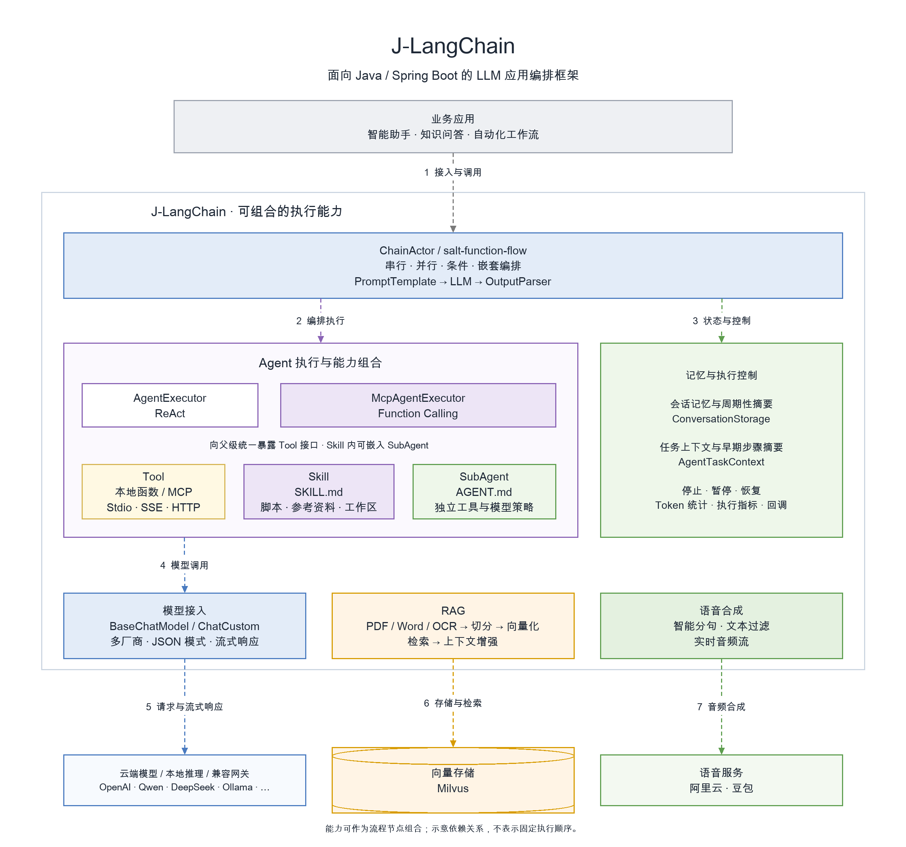

<div align="center">

# J-LangChain

**面向 Java / Spring Boot 的 AI 工作流与 Agent 框架**

将大模型、业务工具、MCP、Skill 和 SubAgent 组合成可控的执行流程。

[](https://search.maven.org/artifact/io.github.flower-trees/j-langchain)
[](./LICENSE)
[](https://www.oracle.com/java/)
[](https://spring.io/projects/spring-boot)

[English](./README.md) | [中文](./README_CN.md)

[快速开始](#quick-start) · [业务工具 Agent](#tool-agent) · [架构](#architecture) · [示例与教程](#examples) · [API](./docs/api/reference_cn.md)

</div>

## 为什么选择 J-LangChain？

| 能力 | 你可以怎样使用 |
|---|---|
| **流程与 Agent 统一编排** | 基于 salt-function-flow，将模型、工具和 Agent 作为流程节点，组合串行、并行、条件和嵌套执行。 |
| **Tool → Skill → SubAgent** | 从注解业务方法开始，逐步接入 MCP、SKILL.md 技能和独立子 Agent，通过 Tool 接口组合能力。 |
| **长任务可控、可观测** | 在安全检查点停止或暂停，携带上下文恢复；通过摘要管理历史，并读取 Token 用量、执行指标和回调。 |

<a id="quick-start"></a>

## 快速开始

准备一个 Java 17、Spring Boot 3.2.x 的 Maven 应用，以及可用的阿里云千问 API Key。模型调用需要网络和可用额度。

**1. 添加依赖**

```xml
<dependency>
    <groupId>io.github.flower-trees</groupId>
    <artifactId>j-langchain</artifactId>
    <version>1.0.19</version>
</dependency>
```

<details>
<summary>Gradle</summary>

```groovy
implementation 'io.github.flower-trees:j-langchain:1.0.19'
```

</details>

**2. 设置环境变量**

```bash
export ALIYUN_KEY="your-api-key"
```

**3. 创建 Application.java**

放到 `src/main/java/com/example/demo/Application.java`。完整示例包括配置导入、模型调用和结果输出。

```java
package com.example.demo;

import java.util.Map;
import org.salt.function.flow.FlowInstance;
import org.salt.jlangchain.config.JLangchainConfig;
import org.salt.jlangchain.core.ChainActor;
import org.salt.jlangchain.core.llm.aliyun.ChatAliyun;
import org.salt.jlangchain.core.parser.StrOutputParser;
import org.salt.jlangchain.core.parser.generation.ChatGeneration;
import org.salt.jlangchain.core.prompt.string.PromptTemplate;
import org.springframework.boot.CommandLineRunner;
import org.springframework.boot.SpringApplication;
import org.springframework.boot.autoconfigure.SpringBootApplication;
import org.springframework.context.annotation.Import;

@SpringBootApplication
@Import(JLangchainConfig.class)
public class Application implements CommandLineRunner {
    private final ChainActor chainActor;

    public Application(ChainActor chainActor) {
        this.chainActor = chainActor;
    }

    public static void main(String[] args) {
        SpringApplication.run(Application.class, args);
    }

    @Override
    public void run(String... args) {
        FlowInstance chain = chainActor.builder()
                .next(PromptTemplate.fromTemplate("用一句话解释 ${topic}"))
                .next(ChatAliyun.builder().model("qwen-plus").build())
                .next(new StrOutputParser())
                .build();

        ChatGeneration result = chainActor.invoke(chain, Map.of("topic", "RAG"));
        System.out.println(result.getText());
    }
}
```

**4. 运行**

```bash
mvn spring-boot:run
```

控制台会输出模型生成的解释。`StrOutputParser` 返回 Generation 对象，使用 `ChatGeneration.getText()` 读取文本。

更多配置和模型切换见 [入门指南](./docs/guide/quickstart_cn.md) 和 [API](./docs/api/reference_cn.md)。

<a id="tool-agent"></a>

## 业务工具 Agent

用 `@AgentTool` 描述业务方法，将已有 Service、Dubbo 或 Feign 调用包装为 Agent 工具。下面用固定订单数据演示工具接入，实际项目中替换为业务服务调用。

在同一包下创建 `OrderAssistant.java`：

```java
package com.example.demo;

import org.salt.jlangchain.core.ChainActor;
import org.salt.jlangchain.core.agent.AgentExecutor;
import org.salt.jlangchain.core.llm.aliyun.ChatAliyun;
import org.salt.jlangchain.rag.tools.annotation.AgentTool;
import org.salt.jlangchain.rag.tools.annotation.Param;

public class OrderAssistant {
    private final ChainActor chainActor;

    public OrderAssistant(ChainActor chainActor) {
        this.chainActor = chainActor;
    }

    @AgentTool("根据订单号查询订单状态")
    public String queryOrder(@Param("订单号，例如 ORD-1001") String orderId) {
        return "ORD-1001".equals(orderId.trim())
                ? "ORD-1001: 已发货，预计明天送达"
                : "未找到该订单";
    }

    public String ask(String question) {
        return AgentExecutor.builder(chainActor)
                .llm(ChatAliyun.builder().model("qwen-plus").build())
                .tools(this)
                .maxIterations(4)
                .build()
                .invoke(question)
                .getText();
    }
}
```

将上面 `Application.run()` 的方法体替换为：

```java
String answer = new OrderAssistant(chainActor)
        .ask("请查询订单 ORD-1001 的状态");
System.out.println(answer);
```

模型根据问题选择工具，框架执行方法并将结果交给模型生成回答。工具路由和最终措辞由模型决定。进一步阅读： [AgentExecutor](./docs/article/001/09-agent-executor.md) · [RPC 工具接入](./docs/article/001/19-rpc-vo-param.md)。

<a id="architecture"></a>

## 架构

<p align="center">
  
</p>

[draw.io 可编辑源文件](./docs/images/v1.0.19-图1_J-LangChain总体架构.drawio)

<a id="examples"></a>

## 示例与教程

| 我想做什么 | 从这里开始 | 所需环境 |
|---|---|---|
| 调用模型、解析输出与流式响应 | [第一个 AI 应用](./docs/article/001/01-hello-ai.md) · [流式输出](./docs/article/001/06-streaming.md) | 对应模型服务；云端调用需 Key 和额度 |
| 将业务方法接入 Agent | [AgentExecutor](./docs/article/001/09-agent-executor.md) · [RPC](./docs/article/001/19-rpc-vo-param.md) | 模型服务与业务工具 |
| 连接 MCP 工具 | [MCP](./docs/article/001/08-mcp.md) · [MCP Agent](./docs/article/001/13-mcp-client-agent.md) | 模型服务、MCP 服务；NPX 示例需要 Node.js |
| 构建文档知识库问答 | [RAG](./docs/article/001/03-rag-pipeline.md) | 示例使用 Ollama、Milvus 和本地文档 |
| 复用技能并组合多个 Agent | [Skill](./docs/article/001/22-skill-agent.md) · [SubAgent](./docs/article/001/23a-subagent-basic.md) · [并行编排](./docs/article/001/18-parallel-agent-concurrent.md) | 模型服务；脚本技能需对应运行时与依赖 |
| 人工确认、暂停与恢复 | [Human-in-the-Loop](./docs/article/001/27-human-in-the-loop.md) · [停止与恢复](./docs/article/001/24-stop-and-resume.md) | 模型服务；恢复时传入保存的上下文 |

[完整中文教程目录](./docs/article/001/README.md) · [可运行示例源码](./src/test/java/org/salt/jlangchain/demo/article/)

## 模型与扩展能力

| 类别 | 支持内容 |
|---|---|
| 模型接入 | OpenAI · Ollama · DeepSeek · Qwen · Moonshot · Doubao · Hunyuan · Qianfan · Zhipu · MiniMax · Lingyi · Stepfun |
| 自定义接口 | `ChatCustom` — 接入 OpenAI Chat Completions 兼容接口 |
| 文档与检索 | PDF / Word / OCR · 文本切分 · OpenAI / Ollama / Aliyun Embeddings · Milvus |
| 语音合成 | 阿里云与豆包 TTS，支持分句、文本过滤和音频流 |
| 状态与观测 | 会话记忆、周期性摘要、任务上下文、Token 用量和执行指标 |

模型的工具调用、JSON 输出和推理内容支持取决于目标服务及模型。 [模型与配置 API](./docs/api/reference_cn.md)

## 文档与开发

| 入口 | 内容 |
|---|---|
| [快速开始](./docs/guide/quickstart_cn.md) | 配置与入门示例 |
| [API 参考](./docs/api/reference_cn.md) | 模型、编排、工具、记忆及回调接口 |
| [发布说明](./docs/release/pr-1.0.19.md) | 版本变化与迁移说明 |
| [构建与验证](./docs/guide/release-validation.md) | 本地回归与集成验收说明 |

在项目根目录运行本地回归及打包检查（需要 Java 17、Maven 和 Python）：

```bash
mvn clean verify -Plocal-tests -Dgpg.skip=true
```

本地配置选择无需真实模型或 MCP 服务的回归测试。供应商、RAG、TTS 等集成用例需要单独准备环境，详见验证说明。

## 参与贡献

欢迎提交 [Issue](https://github.com/flower-trees/j-langchain/issues) 反馈问题或建议，也欢迎通过 [Pull Request](https://github.com/flower-trees/j-langchain/pulls) 贡献代码、测试与文档。

## 开源协议与致谢

[Apache License 2.0](./LICENSE)

基于 [salt-function-flow](https://github.com/flower-trees/salt-function-flow) · [Spring Boot](https://spring.io/projects/spring-boot) · 设计参考 [LangChain](https://github.com/langchain-ai/langchain)

如果项目对你有帮助，欢迎 Star 支持。
